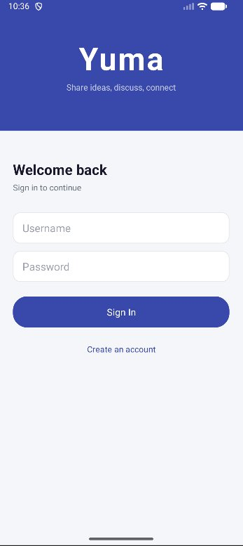

# H2D - Hackathon 2 (Team Dreamers)

A native Android message moderation and social platform built on top of the Hackathon 1 Java backend. The app is called **Yuma** - a public gathering place to share ideas, discuss, and connect.

▶ **[Watch the demo video](https://youtu.be/8i9f6ksx3xQ)**

---

## Screenshot



---

## Team

Omkar, Mayukh, Sudhamsh, Dedeepya and Roshan

---

## Features

- **Login & Registration** - username/password auth with role-based access (Member/Admin)
- **Post Feed** - browse, search, and create posts; tap to view messages
- **Reactions** - tap any message to react with 👍 ❤️ 😂 😡 😢; counts shown per message
- **Pinned Messages** - admins can pin important messages; pinned messages appear at the top of a post
- **Direct Messages** - one-to-one messaging with inbox sorted by Most Recent or Unread First
- **Admin Reports** - admins can view and act on reported messages (hide/unhide)
- **Full Persistence** - all data (posts, messages, reactions, DMs, pins) survives app restarts

---

## Architecture

### Design Patterns

The app uses a consistent set of patterns across all features, mirroring the Hackathon 1 backend vocabulary:

- **Singleton** - `SessionManager`, `ReactionDAO`, `DirectMessageDAO`, `PinDAO`, `MessageDAO`, `UserDAO`, `PostDAO`, `ReportDAO`
- **Factory** - `ReactionSortStrategy.Factory`, `ConversationSortStrategy.Factory`, `ReportSortStrategy.Factory`
- **Iterator** - all `*Tools` query methods return `Iterator<T>`

### SOLID Compliance

New per-message state (reactions, pins) does **not** modify the `Message` model. Reactions live in `ReactionDAO` and pins live in `PinDAO`, both keyed by message UUID. `Message.java` is untouched.

---

## Package Structure

```
android/app/src/main/java/com/dreamers/h2d/
│
├── LoginActivity.java               Login screen (launcher)
├── RegisterActivity.java            Registration
├── MainActivity.java                Post feed with search
├── PostViewerActivity.java          Post detail + messages + pins
├── ProfileActivity.java             User profile
├── UserListActivity.java            Pick a DM recipient
├── InboxActivity.java               DM inbox
├── ConversationActivity.java        DM thread
├── ReportsActivity.java             Admin reports view
│
├── adapters/
│   ├── MessageAdapter.java          Message rows with reactions + hide/unhide
│   ├── PostAdapter.java             Post list rows
│   ├── UserAdapter.java             User list rows
│   ├── ConversationListAdapter.java DM inbox rows
│   └── DMAdapter.java               DM message rows
│
├── common/
│   └── AppInitializer.java          Calls DataManager.readAll() once on startup
│
├── dao/
│   ├── MessageDAO.java              Message store (H1 + clear() fix)
│   ├── PinDAO.java                  Pin store keyed by thread → message UUIDs
│   ├── ReactionDAO.java             Reaction store keyed by message → user → type
│   ├── DirectMessageDAO.java        DM store with conversation indices
│   ├── UserDAO.java / PostDAO.java / ReportDAO.java
│   └── model/
│       ├── Message.java             [unchanged — DO NOT MODIFY]
│       ├── User.java                [unchanged — DO NOT MODIFY]
│       ├── ReactionType.java        LIKE, LOVE, LAUGH, ANGRY, SAD
│       └── DirectMessage.java       id, sender, recipient, timestamp, content, read
│
├── moderation/
│   ├── ModerationTools.java         Report/hide facade (H1)
│   └── ReportSortStrategy.java
│
├── reactions/
│   ├── ReactionTools.java           React/unreact facade
│   └── ReactionSortStrategy.java    MOST / LIKED sort strategies
│
├── messaging/
│   ├── DirectMessageTools.java      Send/query DM facade
│   └── ConversationSortStrategy.java RECENT / UNREAD sort strategies
│
├── pinning/
│   └── PinTools.java                Pin/unpin facade
│
├── session/
│   └── SessionManager.java          Current user singleton
│
└── persistentdata/
    ├── DataManager.java             All 7 CSV pipelines (users, posts, messages,
    │                                reports, reactions, dms, pins)
    └── serialization/
        ├── ReactionSerializer.java
        ├── DirectMessageSerializer.java
        └── PinSerializer.java
```

---

## Getting Started

### Prerequisites

- Android Studio (latest stable)
- JDK 17
- Android SDK API 26+

### Clone and Run

```bash
git clone https://gitlab.comp.anu.edu.au/u7687965/hackathon.git
cd hackathon
git checkout main
```

1. Open Android Studio
2. **File → Open** → select the `android` folder inside the cloned repo
3. Wait for Gradle sync to finish
4. Click the green **▶️ Run** button
5. The app launches on the **Login screen**

### First Run

On a fresh install the app auto-generates random users and posts via `RandomContentGenerator`. Use any generated username/password or register a new account via **Create an account**.

---

## H1 Bug Fix

`ModerationTools.addReport`, `removeReport`, and `setHidden` all check `MessageDAO.getInstance().get(message) == null`. In H1, `MessageDAO` was never populated outside of tests - `DataManager.readAll` only inserted messages into `Post.messages`. So every moderation call silently returned false at runtime.

**Fix applied in this project:**
- `MessageDAO.clear()` added
- `DataManager.readAll()` now also calls `MessageDAO.getInstance().add(message)` inside the message pipeline

---

## Data Persistence

All data is stored as CSV files on the device. `DataManager.writeAll()` is called in `onStop()` of every Activity that modifies data. On next launch, `AppInitializer.init()` calls `DataManager.readAll()` to restore all state.

CSV files: `users`, `posts`, `messages`, `reports`, `reactions`, `dms`, `pins`

---


